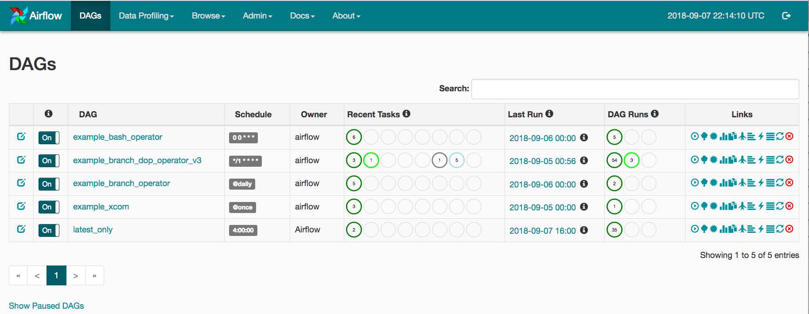

---
title: "Herramientas de integración de datos"
subtitle: "Orquestación de pipelines con Apache Airflow"
format: revealjs
---

## ¿Qué es un orquestador de datos?

Un **orquestador de datos** es una herramienta que permite **programar, coordinar y supervisar la ejecución de pipelines de datos**.

Su función principal es administrar **cuándo y en qué orden deben ejecutarse las operaciones** de un proceso.

Un orquestador puede coordinar las siguientes tareas:

::: incremental
1. Extraer datos de una API.
2. Limpiar los registros obtenidos.
3. Transformar la información.
4. Cargar los resultados en una base de datos.
:::

::: fragment
El orquestador **coordina la ejecución de las tareas**, pero no necesariamente realiza las transformaciones.
:::

## ¿Para qué sirve un orquestador?

En proyectos de ingeniería de datos, los pipelines pueden incluir múltiples tareas que deben ejecutarse periódicamente.

Un orquestador permite:

::: incremental
- **Automatizar:** ejecutar pipelines sin intervención manual.
- **Programar:** establecer horarios o frecuencias de ejecución.
- **Coordinar:** definir dependencias entre tareas.
- **Supervisar:** consultar el estado de las ejecuciones.
- **Recuperar:** reintentar tareas cuando ocurren errores.
:::

::: fragment
**Ejemplo:** ejecutar diariamente un pipeline ETL y notificar cuando alguna tarea falla.
:::

## ¿Qué es Apache Airflow?

**Apache Airflow** es una plataforma de código abierto utilizada para **desarrollar, programar y supervisar workflows**.

En Airflow, los procesos se representan mediante un **DAG (Directed Acyclic Graph)**.

Un DAG es un grafo dirigido sin ciclos que define:


- **Tareas:** operaciones que deben ejecutarse.
- **Dependencias:** orden en que deben ejecutarse.
- **Programación:** cuándo debe iniciarse el proceso.

Los DAGs de Airflow se definen utilizando **Python**.


## ¿Cómo funciona Apache Airflow?

Supongamos que queremos ejecutar un pipeline ETL diariamente.

El proceso incluye tres tareas:

1. **Extraer:** obtener los datos de una fuente.
2. **Transformar:** limpiar y preparar la información.
3. **Cargar:** almacenar los resultados.

La ejecución debe respetar el siguiente orden:

:::{.note}
$$
\text{Extraer}
\longrightarrow
\text{Transformar}
\longrightarrow
\text{Cargar}
$$
:::


Airflow verifica las dependencias y coordina la ejecución de cada tarea.


## ¿Cómo se implementa en Airflow?

En Airflow podemos utilizar Python para definir un DAG y sus tareas.

```{.python code-line-numbers="true"}
from airflow.sdk import dag, task
from datetime import datetime

@dag(
    schedule="@daily",
    start_date=datetime(2026, 1, 1),
    catchup=False
)
def pipeline_etl():

    @task
    def extraer():
        print("Extrayendo datos")

    @task
    def transformar():
        print("Transformando datos")

    @task
    def cargar():
        print("Cargando datos")

    extraer() >> transformar() >> cargar()

pipeline_etl()
```

## ¿Cómo se implementa en Airflow? {.unlisted}

- **`@dag`:** define el workflow que administrará Airflow.
- **`@task`:** identifica las funciones que se ejecutarán como tareas.
- **`schedule="@daily"`:** programa el DAG diariamente.
- **`start_date`:** establece la fecha inicial de programación.
- **`catchup=False`:** evita ejecutar automáticamente los intervalos anteriores pendientes.
- **`>>`:** establece las dependencias entre las tareas.


Airflow utiliza esta definición para **programar y coordinar las ejecuciones del pipeline**.

## Supervisión de pipelines

Apache Airflow proporciona una **interfaz web** para administrar y supervisar los workflows.



## Supervisión de pipelines {.unlisted}

Desde esta interfaz podemos:


- Consultar los DAGs disponibles.
- Revisar las ejecuciones de un pipeline.
- Identificar tareas completadas o fallidas.
- Consultar registros de ejecución (*logs*).
- Ejecutar manualmente un DAG.

Esto facilita la **detección de errores y el seguimiento de los procesos de integración de datos**.


## Recursos para aprender Apache Airflow

Para conocer más sobre **Apache Airflow**, puedes consultar los siguientes recursos:

- 🌐 **[Página oficial de Apache Airflow](https://airflow.apache.org/)**  
  Información general sobre la herramienta.

- 📚 **[Documentación oficial](https://airflow.apache.org/docs/)**  
  Conceptos, funcionalidades y ejemplos.

- 🐍 **[Tutorial de Apache Airflow](https://airflow.apache.org/docs/apache-airflow/stable/tutorial/index.html)**  
  Introducción a la creación de DAGs y tareas con Python.

- 🚀 **[Guía de instalación rápida](https://airflow.apache.org/docs/apache-airflow/stable/start.html)**  
  Instrucciones para comenzar a utilizar Airflow.


## Preguntas

{width="50%"}
